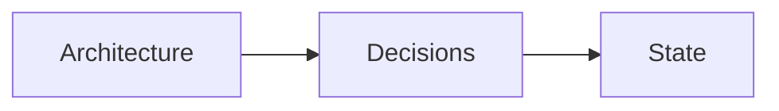
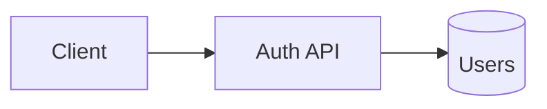

# OBSIDIAN.md — Obsidian for AI Agents: Complete Reference

> **Who this is for:** AI coding agents (opencode, Claude Code, Cursor, Codex, Gemini CLI, Google Antigravity, and any other agent-agnostic runtime) and humans who share the same vaults.
>
> **What it is:** The authoritative reference on what Obsidian is, how vaults work, how to organize and query them, and — most importantly — the *protocols* agents must follow to (a) retrieve exactly the knowledge they need without parsing the whole vault, and (b) write discoveries and decisions back into the vault so every future session inherits them.
>
> **How to read it:** Do **not** read this file top-to-bottom. Read the section you need, when you need it. Sections are self-contained and independently greppable. See [Section 1](#1-purpose--reading-protocol).

---

## Table of contents

1. [Purpose & reading protocol](#1-purpose--reading-protocol)
2. [Core concepts](#2-core-concepts)
3. [Obsidian Flavored Markdown (OFM)](#3-obsidian-flavored-markdown-ofm)
4. [Vault architecture & organization](#4-vault-architecture--organization)
5. [Metadata schema (properties + registry)](#5-metadata-schema-properties--registry)
6. [Structured data & querying](#6-structured-data--querying)
7. [The index tree system](#7-the-index-tree-system)
8. [The retrieval protocol](#8-the-retrieval-protocol)
9. [The write-back protocol](#9-the-write-back-protocol)
10. [Two-vault agent memory design](#10-two-vault-agent-memory-design)
11. [Automation layer (optional)](#11-automation-layer-optional)
12. [Agent behavior rules](#12-agent-behavior-rules)
13. [Pitfalls & gotchas](#13-pitfalls--gotchas)
14. [Resources](#14-resources)

---

## 1. Purpose & reading protocol

### 1.1 The core idea

An Obsidian vault is **just a folder of plain Markdown files**. Nothing more. Obsidian itself is only a rendering/graph/query layer on top of those files. This matters enormously for agents:

- An agent **never needs Obsidian running** to use a vault. It's files on disk.
- The "power" is in **conventions**: wikilinks, YAML frontmatter/properties, folders, and indexes — all plain text.
- Markdown is the lingua franca of AI tools. What the agent reads and writes is exactly what Obsidian renders.

This is why vaults make a good **persistent brain for agents**: session memory dies, files don't.

### 1.2 Two vault kinds

1. **Global vault** — cross-project context: the user's coding preferences, a registry of every project (where its vault is, what it does, its status), and general knowledge. Acts as the GPS.
2. **Per-project vault** — lives inside the project directory (default `.brain/`), holds that project's brain: decisions, architecture, session logs, glossary, state. A new agent in that project reads this vault instead of re-exploring from scratch.

Full design in [Section 10](#10-two-vault-agent-memory-design).

### 1.3 Reading rules for agents (IMPORTANT)

- **Never parse the whole vault.** Do not glob-and-read every `.md` file.
- Use the **index tree** ([§7](#7-the-index-tree-system)) to find the right branch, then the **retrieval protocol** ([§8](#8-the-retrieval-protocol)) to reach only the notes you need.
- Read this document's sections **on demand**, by their headers/titles, not all at once.
- When the human says "check my vault / brain / notes", start at the vault's `INDEX.md`, not a recursive file listing.

---

## 2. Core concepts

| Concept | What it is | When it matters for an agent |
|---|---|---|
| **Vault** | A folder of files Obsidian treats as one workspace | The search/link/query boundary is the whole vault. Folders are soft boundaries. |
| **Note** | A `.md` file. Filename = the note's title by default | Renaming a file changes its identity; wikilinks auto-update in Obsidian but a plain-text agent must update `[[links]]` itself. |
| **Property / frontmatter** | YAML block at the top of a note (`---` ... `---`) | The metadata layer. Consistency is what makes querying work ([§5](#5-metadata-schema-properties--registry)). |
| **Wikilink** | `[[Note Name]]`, `[[Note#Heading]]`, `[[Note|display]]` | The connective tissue. Vaults are graphs, not file trees. |
| **Backlink** | A link *pointing at* the current note | Reveals related knowledge an agent might otherwise miss. |
| **Tag** | `#tag`, `#nested/tag` | A signal for discovery/filtering — *not* a substitute for structure. |
| **Graph view** | Visual of notes as nodes and links | Orientation only. Agents can't "see" it; infer structure from links instead. |
| **Daily note** | Auto-created note per day (e.g. `2026-08-07.md`) | The inbox for session-scoped facts before they migrate into atomic notes. |
| **Canvas** | `.canvas` file — a visual board of cards/notes | JSON. Rare for agent use; skip unless asked. |
| **Base** | `.base` file — a database view over note properties | Structured, queryable tables ([§6](#6-structured-data--querying)). |
| **Attachment** | Images, PDFs, audio referenced via `![[file.png]]` | Keep in a dedicated folder; embed, don't paste. |
| **`.obsidian/`** | Obsidian's own config folder (settings, plugins, themes) | Do not edit or commit unless asked. |

**Mental model:** a vault is a **folder of markdown + a web of links + a layer of YAML metadata**. Everything an agent needs to be useful is in the text, the links, and the properties.

---

## 3. Obsidian Flavored Markdown (OFM)

Obsidian extends CommonMark + GitHub-Flavored Markdown. Standard markdown (headings, bold, italic, lists, quotes, code blocks, tables, links) is assumed knowledge. **The extensions below are the Obsidian-specific parts.**

### 3.1 Internal links (wikilinks)

```markdown
[[Note Name]]                        Link to note
[[Note Name|Display Text]]           Custom display text
[[Note Name#Heading]]                Link to a heading
[[Note Name#^block-id]]              Link to a block
[[#Heading in same note]]            Heading link within the current note
```

- Block IDs: append `^id` to a paragraph, or on a line after a list/quote block:

```markdown
This paragraph can be linked to. ^my-block-id
```

- **Rule:** use `[[wikilinks]]` for notes inside the vault; use `[text](url)` for external URLs only.
- **Rule for plain-text agents:** wikilinks are NOT auto-updated on the filesystem when a file is renamed (Obsidian does this internally, but your edits are text). If you rename/move a note, grep the vault for `[[old name]]` and update every reference.

### 3.2 Embeds (transclusion)

```markdown
![[Note Name]]                        Embed full note
![[Note Name#Heading]]                Embed a section
![[image.png]]                        Embed an image
![[image.png|300]]                    Embed image at width 300px
![[document.pdf#page=3]]              Embed a specific PDF page
![[video.mp4]]                        Embed a video
```

- Prefix any wikilink with `!` to embed its content inline.
- Useful for composing "dashboard" notes that pull in several other notes without duplication.

### 3.3 Callouts

```markdown
> [!note] Title
> Body text. Supports **markdown**, [[wikilinks]], and ![[embeds]].

> [!warning]- Collapsed by default
> Foldable callout (`-` collapsed, `+` expanded).
```

Common types (case-insensitive, aliases allowed):

`note`, `tip`, `hint`, `important`, `warning`, `caution`, `attention`, `danger`, `error`, `bug`, `example`, `quote`, `abstract`, `summary`, `tldr`, `info`, `todo`, `success`, `check`, `done`, `question`, `help`, `faq`, `failure`, `fail`, `missing`.

- Agents should use callouts for emphasis in notes they write: `> [!warning]` for risks, `> [!info]` for context, `> [!todo]` for pending work.

### 3.4 Properties (YAML frontmatter)

```yaml
---
title: My Note
date: 2026-08-07
tags:
  - project
  - active
aliases:
  - Alternative Name
cssclasses:
  - custom-class
type: decision
status: approved
---

# Content starts here
```

- Frontmatter must be the **very first** thing in the file, between `---` fences.
- Core/reserved properties: `tags`, `aliases`, `cssclasses`.
- Custom properties are the foundation of querying ([§6](#6-structured-data--querying)). **Consistency of key names and types is everything.**
- Full reference: https://help.obsidian.md/properties

### 3.5 Tags

```markdown
#tag
#nested/tag
```

- Inline `#tag` anywhere in prose, or a `tags:` list in frontmatter.
- Nested tags create a hierarchy. **Do not nest more than 2 levels** (`#project/active` fine; `#project/active/q2/2026` will not be remembered).
- Keep the active tag set small (5–10). Tags are signals, not structure.

### 3.6 Other syntax

```markdown
==highlight==          Highlighted text
%%hidden comment%%     Comment (not rendered in Reading view)
^my-block-id           Block reference
[^1] and [^1]: ...     Footnotes (reference style)
^[inline footnote]     Inline footnotes
$math$ and $$math$$    LaTeX math (single `$` for inline is allowed)
```

### 3.7 Diagrams

```markdown

```

- Mermaid renders natively. Supported: flowcharts, sequence, class, state, gantt, pie.
- Use mermaid for architecture diagrams in project vaults — it's plain text, versionable, and diffable.

### 3.8 Full example note

```markdown
---
title: Auth Service Architecture
type: architecture
status: active
tags:
  - project/backend
  - auth
updated: 2026-08-07
---

# Auth Service Architecture

## Overview
The auth service issues RS256 JWTs. Tokens expire after 15 minutes.

> [!warning] Key constraint
> Refresh tokens must be rotated; see [[Auth Decisions#Token rotation]].

## Diagram


## Related
- [[Auth Decisions]]
- [[Session 2026-08-07]]
```

---

## 4. Vault architecture & organization

### 4.1 The organizing principles

- **Links over folders.** A file lives in one folder but can link to unlimited others. Prefer flat/shallow folders + rich links over deep hierarchies.
- **MOCs (Maps of Content)** are index notes that link all the notes of a topic. They are the navigation layer.
- **Tags are signals, not structure.** Use for discovery/filtering, not for where a note lives.
- **Folders for true separation only** (e.g. `Decisions/` vs `Journal/`), kept shallow (≤ 2–3 levels).

### 4.2 Proven systems (pick one or hybrid)

| System | Idea | Best for |
|---|---|---|
| **PARA** | Organize by actionability: **P**rojects, **A**reas, **R**esources, **A**rchives | Work, projects, tasks, execution |
| **Zettelkasten** | Atomic notes, each an idea, densely linked, numbered IDs optional | Long-term knowledge, thought development |
| **Johnny Decimal** | Every note gets a permanent `XX.YY` ID, bounded 10×10 scope | Systematic, numbered, cross-system reference |
| **Hybrid (recommended)** | PARA for top-level folders, Zettelkasten-style atomic notes, MOCs as navigation | Most practical, scales with agent-maintained indexes |

### 4.3 Recommended hybrid layout for an agent-managed vault

```
vault/
├── INDEX.md                     ← root map (area-level links + summaries)
├── registry.yaml                ← root registry (machine-readable)
├── 10 Projects/                 ← each active project (PARA)
│   ├── INDEX.md
│   ├── registry.yaml
│   └── <project>/
│       ├── project-state.md
│       ├── decisions.md         (or per-decision notes)
│       ├── architecture.md
│       └── session-logs/
├── 20 Areas/                    ← ongoing responsibilities
│   ├── INDEX.md
│   └── registry.yaml
├── 30 Resources/                ← reference, never-stale
│   ├── INDEX.md
│   └── registry.yaml
├── 40 Archive/                  ← done / no longer relevant
│   └── INDEX.md
├── 90 Meta/                     ← templates, conventions, glossary
│   ├── templates/
│   └── glossary.md
└── attachments/                 ← images, pdfs (default embed location)
```

### 4.4 Organization DO/DON'T

- **DO** keep folders shallow; let links and MOCs carry depth.
- **DO** create a new `INDEX.md` + `registry.yaml` when a branch grows past ~20–30 notes ([§7](#7-the-index-tree-system)).
- **DON'T** build an 8-level tag hierarchy; duplicate tags are worse than none.
- **DON'T** leave orphan notes (no incoming/outgoing links) piling up — detect and link or archive ([§8.4](#84-orphan--dead-link-hygiene)).
- **DON'T** move a note without updating its links and its registry entry.

---

## 5. Metadata schema (properties + registry)

### 5.1 Why a schema

Querying works only when property **key names and types are consistent** across notes. A half-filled, inconsistently-keyed vault is noise. Decide a small property set per note type and apply it via templates.

### 5.2 Recommended common properties

```yaml
---
type: decision            # note type: decision | architecture | session | discovery | resource | project | person | glossary
status: active            # draft | active | deprecated | archived
title: Human title        # optional; filename is title by default
tags: [project/backend]   # 5-10 tags max, ≤2 levels
aliases: [Other Name]     # alternative names for link suggestions
created: 2026-08-07       # YYYY-MM-DD
updated: 2026-08-07       # bumped by write-back protocol
priority: high            # for tasks/projects
due: 2026-09-01           # ISO date
```

Type-specific examples:

```yaml
# decision note
type: decision
status: approved
decided: 2026-08-07
supersedes: "[[2026-07-15 token storage]]"

# session log
type: session
project: my-app
started: 2026-08-07T10:00
ended: 2026-08-07T12:00

# project note
type: project
repo: https://github.com/user/repo
vault_path: .brain
health: healthy          # healthy | risky | stalled
```

### 5.3 The registry schema (`registry.yaml`)

The registry is the agent's precise navigation table. Keep it **small and summary-only** — one entry per note, no bodies.

```yaml
# registry.yaml  (root or branch level)
version: 1
updated: 2026-08-07
areas:
  - name: Projects
    path: 10 Projects
    description: Active projects and their state
    index: "10 Projects/INDEX.md"

notes:
  - name: Auth Service Architecture
    path: "10 Projects/auth/architecture.md"
    type: architecture
    status: active
    tags: [project/backend, auth]
    summary: RS256 JWT auth service; 15min token expiry; refresh rotation.
    links: ["Auth Decisions"]
    updated: 2026-08-07
  - name: Token Rotation Decision
    path: "10 Projects/auth/decisions/2026-08-05-token-rotation.md"
    type: decision
    status: approved
    tags: [project/backend, auth]
    summary: Refresh tokens rotate every 24h; revoked on password change.
    updated: 2026-08-05
```

Field rules for `notes[]`:
- `name` — display name (should match filename without `.md`).
- `path` — **relative path from vault root**, always. The only thing an agent may use for `read`/`edit`.
- `type`, `status`, `tags` — mirror frontmatter.
- `summary` — 1–2 sentences max; the whole point of the registry is that agents can pick the right note from a summary without opening it.
- `updated` — ISO date; bump on write-back.
- `links` — optional short list of related note names.

**Keep the root `registry.yaml` under ~200 lines.** When it grows, that's the signal to add branch registries ([§7](#7-the-index-tree-system)).

### 5.4 INDEX.md ↔ registry.yaml are mirrors

- `INDEX.md` = human/overview form (markdown tree with wikilinks).
- `registry.yaml` = machine form (parseable metadata).
- Both are edited together by the write-back protocol; never edit one without the other.

---

## 6. Structured data & querying

Three layers, newest to oldest. **Bases** is built-in and the right default for most agent-visible tables. **Dataview** (community plugin) is for task rollups, inline queries, and JS. Agents usually only *read* these; they write properties.

### 6.1 Properties (core, foundation)

The raw metadata layer ([§5](#5-metadata-schema-properties--registry)). Everything below reads this. **Get the properties right first; queries are only as good as the metadata.**

### 6.2 Bases (core, built-in since Obsidian 1.9)

A `.base` file defines database views over note properties: table, list, cards, map. Filters/formulas use an expression language. A `.base` is a YAML file:

```yaml
# 10 Projects/base.base
filters:
  and:
    - file.inFolder("10 Projects")
    - 'status != "done"'
views:
  - type: table
    name: Open projects
    order:
      - file.name
      - status
      - priority
      - due
```

Key syntax points:
- **File properties:** `file.name`, `file.basename`, `file.path`, `file.folder`, `file.ext`, `file.size`, `file.tags`, `file.links`, `file.ctime`, `file.mtime`, `file.properties`.
- **Note properties:** bare `property_name` or `note.property_name`.
- **Filters combine with** `and` / `or` / `not`.
- Embed a base in a note with `![[mybase.base]]`.

### 6.3 Dataview (community plugin)

DQL queries live in a code block inside a note:

```md
```dataview
TABLE status, priority, due
FROM "10 Projects"
WHERE status != "done" AND due != null
SORT due ASC
```
```

- `FROM` accepts a folder `"10 Projects"`, a tag `#project`, or a link.
- Use **Bases** unless you need: task aggregation across notes (`TASK`), inline queries inside prose, or JS (`dataviewjs`). Those are Dataview-only.
- Full docs: https://blacksmithgu.github.io/obsidian-dataview/

### 6.4 Choice guide

| Need | Tool |
|---|---|
| Filtered/sortable/editable table of notes | **Bases** (nothing to install) |
| Task rollup across all notes | **Dataview** `TASK` |
| Inline value inside a sentence | **Dataview** inline |
| Custom scripting | **DataviewJS** |
| Machine-read a view for an agent | Open the `.base` YAML directly (it's plain text) |

**Agent note:** never rely on a rendered view; read the `.base` file or run the query yourself against the metadata. Your source of truth is properties in the `.md` files.

---

## 7. The index tree system

### 7.1 The problem it solves

A vault grows. Reading 2,000 notes to answer one question is wasteful and wrong. The index tree bounds the cost: **reading grows logarithmically with vault size**, not linearly.

### 7.2 Structure

```
vault/
├── INDEX.md            ← root map
├── registry.yaml       ← root registry (areas + all entries, summarized)
├── 10 Projects/
│   ├── INDEX.md        ← branch map
│   ├── registry.yaml   ← branch registry
│   └── ...
└── 30 Resources/
    ├── INDEX.md
    ├── registry.yaml
    └── Docker/
        ├── INDEX.md    ← sub-index when this branch grew deep
        └── registry.yaml
```

Rules:
1. The **root** `INDEX.md` and `registry.yaml` always exist.
2. Each **top-level area** (`10 Projects`, `30 Resources`, …) has its own `INDEX.md` + `registry.yaml`.
3. A branch gets a **sub-index** when it exceeds ~20–30 notes or ~150 lines of registry. The parent's `INDEX.md` links to the sub-index; the sub-index's notes are removed from the parent registry (kept as a single `points to sub-index` entry).
4. `INDEX.md` files link down (to child indexes and key notes); `registry.yaml` files hold the machine-readable entries at that level.

### 7.3 INDEX.md format

```markdown
# INDEX — 10 Projects

> Branch registry: `10 Projects/registry.yaml`

## Projects
- [[auth]] — RS256 JWT auth service (active)
- [[billing]] — Stripe integration (risky — see [[billing/state]])

## Decisions
- [[2026-08-05 token rotation]] — approved

## Sub-indexes
- [[10 Projects/legacy/index]] — retired monolith notes
```

An agent reads this to get the shape of the branch, then jumps to the 1–3 notes it needs.

### 7.4 Adding a sub-index (step-by-step, for agents)

1. Create `NEWBRANCH/INDEX.md` and `NEWBRANCH/registry.yaml`.
2. Move entries out of the parent `registry.yaml` into the branch registry; leave a pointer entry: `name: legacy, type: index, path: NEWBRANCH/index.md, summary: sub-index`.
3. Update the parent `INDEX.md` with a `## Sub-indexes` link.
4. Bump `updated:` in both registries.
5. Git commit.

### 7.5 Freshness rules

- Every `registry.yaml` and `INDEX.md` carries `updated: <date>`.
- The write-back protocol ([§9](#9-the-write-back-protocol)) keeps entries current after every session.
- If an agent finds a stale entry (summary wrong, path 404, status outdated), **fix it** — a brain that contradicts reality is worse than no brain. Reindex then commit.

---

## 8. The retrieval protocol

**Goal:** reach the exact knowledge needed with the minimum reads. Strict order; never skip.

### 8.1 Step 1 — Orient (1 file, ~50–150 lines)

Read the vault root `INDEX.md`. If it doesn't exist, read `registry.yaml`. You now know the branches and the key notes.

### 8.2 Step 2 — Narrow (1 file)

Identify the relevant branch from the root index. Read that branch's `INDEX.md` and/or `registry.yaml`. For a deep branch, follow a sub-index.

### 8.3 Step 3 — Select (by summary)

From the branch registry, pick notes whose `summary` matches your task. **Do not open notes whose summaries are irrelevant.**

### 8.4 Step 4 — Read (targeted)

Read only the selected notes (`path` from the registry). Use heading/block refs when you only need a section.

### 8.5 Step 5 — Search as the needle

If the index path dead-ends or you need something not in the registry:

1. `rg -l "pattern" <vault>` for a first-pass scan (exact, fast, no Obsidian needed).
2. Search with a **specific** query — never a bare "everything".
3. Read the top 3–5 matches; confirm they're on-topic from their frontmatter `type`/`status`/`summary` before reading bodies.

> Prefer `rg` over `find`. Use `find` only to confirm a path exists.

### 8.6 Step 6 — Validate

Before acting on vault knowledge, sanity-check: is the note's `status` current (`active` vs `deprecated`)? Does the `updated` date look too old for a fast-moving topic? Is there a newer decision that `supersedes` it? **Stale facts are a bigger risk than missing facts.** If you act on a stale note, say so to the human.

### 8.7 Orphan & dead-link hygiene

- **Orphan:** no incoming/outgoing links. Fix by linking it to an MOC/INDEX or archiving it.
- **Dead link:** `[[Note]]` pointing to a non-existent file. Fix the target or the reference.
- Agents performing write-back should run a quick orphan/dead-link check on any branch they touch and fix what they caused or find (then commit).

---

## 9. The write-back protocol

**Goal:** every session leaves the vault more correct than it found it. The vault is an agent-first brain — agents add, update, and prune information using their own judgment.

### 9.1 What to write back

Capture anything that would help a future session:

- **Decisions** and why (ADR-style, even 3 lines).
- **Architecture facts** (components, data flow, constraints).
- **Discoveries / gotchas** (things that cost time; edge cases; non-obvious behavior).
- **Session state** (what was done, what's next, open questions).
- **Corrections** (stale notes, wrong assumptions).

### 9.2 Where it goes

| Content | Destination |
|---|---|
| Decision with lasting impact | `10 Projects/<p>/decisions/YYYY-MM-DD-<slug>.md` |
| Architecture facts | `10 Projects/<p>/architecture.md` (or create if missing) |
| Quick session facts | `10 Projects/<p>/session-logs/YYYY-MM-DD.md` |
| Cross-project knowledge | `30 Resources/` |
| Project status / next steps | `10 Projects/<p>/project-state.md` |
| Terms / acronyms | `90 Meta/glossary.md` |

New notes: create via the vault template ([§9.4](#94-templates)). Never write a note without frontmatter.

### 9.3 The 5-step write-back loop

1. **Decide.** Is this worth keeping? Will a future session care? If it's noise, skip it. If it's stale, prune it (delete or archive — update links first).
2. **Write.** Create or append to the right note with correct frontmatter, wikilinks to related notes, and a `summary`-grade first paragraph.
3. **Reindex.** Update that branch's `registry.yaml` (add/update/remove the `notes:` entry) **and** its `INDEX.md` (mirror). Bump `updated:`.
4. **Validate.** Check your own links resolve; confirm you didn't leave the branch's registry inconsistent.
5. **Commit.** `git add` + `git commit` with a clear message ([§9.5](#95-git--commit-discipline)).

### 9.4 Templates

Templates live in `90 Meta/templates/`. The convention is one template per note `type`. A new note is created by copying the template and filling fields. (Templater plugin is optional automation; the plain convention works everywhere.)

```markdown
# 90 Meta/templates/decision.md
---
type: decision
status: draft
created: {{date}}
updated: {{date}}
tags: []
---

# <Title>

## Context
What led to this decision?

## Decision
What was decided?

## Alternatives considered
-

## Consequences
-
```

### 9.5 Git & commit discipline

- **Global vault:** own git repo. Commit after every session or batch of write-backs.
- **Project vault (`.brain/`):** commit to the project repo, OR gitignore it if the user prefers it out of the code history (ask/confirm once; respect the choice thereafter).
- Commit messages: `vault(<area>): <what changed>` e.g. `vault(10 Projects/auth): add token rotation decision, reindex`.
- Never commit `.obsidian/` (app config) unless the user says so — it churns.
- If git is unavailable, leave a `pending-commits.md` in `90 Meta/` and tell the human.

### 9.6 Agent autonomy & judgment

- The agent has **discretion**: add or remove information it deems worth keeping.
- **Don't delete without a trace:** before pruning a note, ensure it's archived or that the superseding note links it.
- **When in doubt:** keep it, update it, or flag it — don't silently drop user-authored content.

---

## 10. Two-vault agent memory design

### 10.1 The global vault (the GPS)

Purpose: cross-project context + registry of projects. Location is up to the user (e.g. `~/brain/` or `~/vaults/global/`).

```
global-vault/
├── INDEX.md
├── registry.yaml
├── 10 Projects/                 ← one entry per project, NOT full project notes
│   ├── INDEX.md
│   └── registry.yaml
├── 20 Preferences/              ← coding prefs: languages, style, tooling, conventions
├── 30 Knowledge/                ← general/reusable knowledge
├── 40 Archive/
└── 90 Meta/                     ← templates, glossary
```

Project entries carry **where to find the project vault**:

```yaml
notes:
  - name: my-app
    type: project
    path: "10 Projects/my-app.md"
    summary: E-commerce backend; Node/TS, Postgres, Redis.
    vault_path: /home/user/code/my-app/.brain
    repo: https://github.com/user/my-app
    status: active
    updated: 2026-08-07
```

**Retrieval rule:** a new agent facing an unknown project reads the global registry → finds `vault_path` → jumps to the project vault's `INDEX.md`. It does not scan the user's disk.

### 10.2 The per-project vault (the brain)

Lives inside the project directory, default name **`.brain/`** (hidden, short, unambiguous). Obsidian opens it as its own vault; the agent treats it as the project's long-term memory.

```
my-app/
├── .brain/                      ← project brain (this is the vault)
│   ├── INDEX.md
│   ├── registry.yaml
│   ├── project-state.md         ← current status, next steps (updated every session)
│   ├── decisions/               ← YYYY-MM-DD-<slug>.md ADRs
│   ├── architecture.md
│   ├── discoveries.md           ← gotchas, non-obvious behavior
│   ├── session-logs/            ← YYYY-MM-DD.md
│   └── glossary.md
├── .gitignore                   (decide: commit .brain or not)
├── AGENTS.md                    ← short pointer to the brain (optional but recommended)
└── src/ ...
```

A per-project `AGENTS.md` (or `CLAUDE.md`, or opencode's rules) should contain one line:

```markdown
Project memory lives in `.brain/`. Start by reading `.brain/INDEX.md`.
```

### 10.3 The handshake (new agent entering a project)

1. Read project's `AGENTS.md` / rules → sees `.brain/`.
2. Read `.brain/INDEX.md` (+ `registry.yaml`) → orient.
3. Read `project-state.md` → current state and next steps.
4. Read the 1–3 notes relevant to the task (per [§8](#8-the-retrieval-protocol)).
5. Work.
6. Write back per [§9](#9-the-write-back-protocol), update `project-state.md`, commit.

### 10.4 What NOT to put in a project vault

- Source code (the repo already has it) — link to it or summarize.
- Anything the user marked private, or secrets/keys. **Never write credentials into a vault.**
- Ephemeral chit-chat. The vault is for what outlives the session.

---

## 11. Automation layer (optional)

The file-based protocol works with **zero setup** — Obsidian doesn't need to be running. These tools are *optional* conveniences when Obsidian is actually running.

### 11.1 Official Obsidian CLI

- Requires Obsidian **running**, and CLI enabled in Settings → General.
- 115 commands: notes (create/read/append), search, properties, daily notes, tags, backlinks, tasks, bases, plugin/theme management, dev tools.
- Syntax: `obsidian create name="Note" content="..."`, `obsidian search query="term"`, `obsidian property:set name=status value=done file="Note"`.
- **File targeting:** `file=<name>` resolves like a wikilink (no path/ext); `path=<path>` is exact from vault root. Know which you're using.
- **Vault targeting:** `obsidian vault="Name" <cmd>` as the first parameter for multi-vault.
- Docs: https://help.obsidian.md/cli

### 11.2 Local REST API + built-in MCP server (community plugin)

- Plugin: `obsidian-local-rest-api`. Exposes REST at `https://127.0.0.1:27124` and a built-in MCP endpoint at `/mcp/`.
- Gives agents CRUD, **surgical section patching** (target a heading/block/property), full-text + JsonLogic structured search, access to the active file.
- Works while the app runs; API-key auth; localhost by default.
- There are also standalone MCP servers that work **without** Obsidian running — prefer those for a headless/CI setup.

### 11.3 Third-party agent CLIs (e.g. `obsidian-agent-cli`)

- Python CLI with JSON output, AI-workspace concept (a dedicated folder the agent owns), dual transport (REST API when Obsidian runs, filesystem fallback otherwise).
- Not required; the plain-file protocol is the baseline that always works.

### 11.4 Priority for agents

1. **Plain files** (read/edit via your file tools) — always works, no app.
2. `rg`/`find` for search.
3. Obsidian CLI / REST API / MCP — only when Obsidian is confirmed running and the user asks for live-vault behavior (e.g. working with the currently-open note).

---

## 12. Agent behavior rules

The contract. Violating these degrades the vault for everyone.

### DO

- **Read-first:** orient via INDEX/registry before touching files ([§8](#8-the-retrieval-protocol)).
- **Write-back:** persist decisions/discoveries/state before finishing ([§9](#9-the-write-back-protocol)).
- **Follow templates** for new notes; always include frontmatter.
- **Use wikilinks** to related notes (internal), markdown links for URLs.
- **Keep summaries short** in the registry — they exist so others don't open notes.
- **Keep properties consistent** in key names and types ([§5](#5-metadata-schema-properties--registry)).
- **Bump `updated`** and reindex whenever you change a note or registry.
- **Commit** after write-backs with a clear message.
- **Fix what you break:** dead links, stale entries, orphans you created.
- **Say when you rely on a stale note** or when the vault contradicts reality.

### DON'T

- **Don't parse the whole vault** (no recursive read-all). Index → search → targeted read.
- **Don't skip the index** and grep blindly as the first move.
- **Don't delete notes** without archiving or updating links/registry first.
- **Don't write secrets/keys/credentials** into any vault.
- **Don't edit `.obsidian/`** unless explicitly asked.
- **Don't nest tags 3+ levels** or invent new tags willy-nilly.
- **Don't duplicate knowledge** — link instead. If a fact exists in two places, pick one and link.
- **Don't leave `INDEX.md` and `registry.yaml` out of sync** — they are mirrors.
- **Don't commit vault noise** (`.obsidian/`, attachments you didn't intend).

### ASK

- When the user's instruction conflicts with these rules.
- When pruning/restructuring would destroy user-authored content.
- When unsure whether a fact belongs in the vault at all (prefer keeping + flagging over dropping).

---

## 13. Pitfalls & gotchas

| Pitfall | Reality / fix |
|---|---|
| `file=` vs `path=` | CLI `file=` resolves wikilink-style (no ext/path); `path=` is exact. Mixing them causes "not found". |
| Wikilinks don't auto-rename for text agents | Rename/move a file → grep and update every `[[old name]]` reference. |
| Frontmatter must be first | Content before `---` breaks the properties parse. |
| `#` in filenames | `[[Note # Name]]` — Obsidian escapes spaces; prefer no `#` in filenames. |
| Inline fields vs properties | Dataview reads inline `key:: value` too; Bases reads only frontmatter. Keep data in frontmatter for Bases compatibility. |
| Empty vs missing property | `status != "done"` excludes notes with no `status`. Queries must handle missing fields deliberately. |
| Tag sprawl | Duplicate tags for the same concept accumulate. Keep ≤10 active tags, ≤2 levels. |
| Stale registry entries | The registry's whole value is freshness. Fix stale `summary`/`path`/`status` on sight. |
| Orphan notes | Notes with no links get lost forever. Link to an INDEX/MOC or archive. |
| Huge vault slowness (app) | Sub-indexes and shallow folders keep Obsidian's metadata cache fast too. |
| `.obsidian/` churn | App config changes constantly. Gitignore it in the project repo. |
| Hidden `.brain/` in some tools | If the agent's file tools skip dotfolders, ensure rules/tools allow reading it (or rename to `brain/`). |
| Secrets in vault | A brain is versioned in git. Never store keys/tokens; point to the real secret store. |

---

## 14. Resources

- Obsidian Help (official): https://help.obsidian.md
- Obsidian Flavored Markdown: https://help.obsidian.md/obsidian-flavored-markdown
- Properties: https://help.obsidian.md/properties
- Bases: https://obsidian.md/help/bases
- Callouts: https://obsidian.md/help/callouts
- Obsidian CLI: https://help.obsidian.md/cli
- Local REST API + MCP plugin: https://github.com/coddingtonbear/obsidian-local-rest-api
- kepano/obsidian-skills (agent skills for OFM, Bases, Canvas, CLI, Defuddle): https://github.com/kepano/obsidian-skills
- Dataview plugin: https://github.com/blacksmithgu/obsidian-dataview
- Agent Skills specification: https://agentskills.io/specification

---

*This document is intentionally long and sectioned so agents load only what they need. Keep it at the root of every vault (or referenced from `AGENTS.md`), and keep it in sync with reality as the conventions evolve.*
