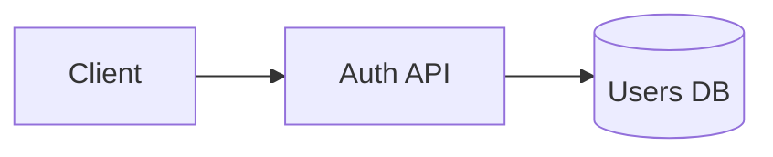
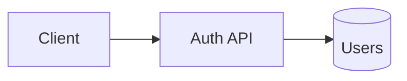

# 03. Metadata Schema & Syntax Reference

**Goal:** Ensure 100% consistency across YAML properties, note metadata, and Obsidian Flavored Markdown (OFM) extensions so queries and automated tools parse cleanly.

---

## 1. Why a Schema is Required

Querying works **only** when property key names and data types are consistent across notes. A half-filled, inconsistently-keyed vault is noise. Decide on a minimal, standardized property set per note type and enforce it via templates.

---

## 2. Frontmatter Properties Schema

Every note in a vault MUST begin with a YAML frontmatter block between `---` fences.

### Common Properties

```yaml
---
title: Note Title
type: decision            # decision | architecture | session | project | discovery | resource | person | glossary
status: active            # draft | active | approved | deprecated | archived
created: YYYY-MM-DD       # ISO creation date
updated: YYYY-MM-DD       # ISO last modified date (bumped on write-back)
priority: high            # high | medium | low (for tasks/projects)
due: YYYY-MM-DD           # ISO due date (for tasks/projects)
tags:
  - project/backend
  - auth
aliases:
  - Token Rotation ADR
cssclasses:
  - custom-class
---
```

### Type-Specific Properties Examples

```yaml
# Decision note
type: decision
status: approved
decided: 2026-08-07
supersedes: "[[2026-07-15-old-auth]]"

# Session log note
type: session
project: my-app
started: 2026-08-07T10:00
ended: 2026-08-07T12:00

# Project note
type: project
repo: https://github.com/user/repo
vault_path: .brain
health: healthy          # healthy | risky | stalled
```

---

## 3. Machine Registry Schema (`registry.yaml`)

The `registry.yaml` file provides machine-readable metadata for fast lookup and summary-based selection.

```yaml
version: 1
updated: 2026-08-07
notes:
  - name: Auth Architecture
    path: "decisions/architecture.md"
    type: architecture
    status: active
    tags: [project/backend, auth]
    summary: RS256 JWT authentication flow with 15-minute access token expiry.
    links: ["Token Rotation Decision"]
    updated: 2026-08-07
```

### Field Requirements
- `name`: Note display title (without `.md`).
- `path`: Relative path from the vault root (always use forward slashes).
- `type`: Matches note frontmatter `type`.
- `status`: Matches note frontmatter `status`.
- `summary`: 1–2 sentence summary of note content.
- `updated`: ISO date (`YYYY-MM-DD`).
- `links`: (Optional) short list of related note names.

> [!IMPORTANT] Mirror & Size Rules
> 1. `INDEX.md` and `registry.yaml` are dual representations. `INDEX.md` is human/markdown-formatted; `registry.yaml` is machine-parseable YAML. Both MUST be kept in sync during write-back.
> 2. **Keep the root `registry.yaml` under ~200 lines.** When it grows larger, add branch registries ([04-index-tree-system.md](04-index-tree-system.md)).

---

## 4. Obsidian Flavored Markdown (OFM) Extensions

### Internal Links (Wikilinks)
```markdown
[[Note Name]]                        Link to note
[[Note Name|Display Text]]           Link with custom display text
[[Note Name#Heading]]                Link to specific heading
[[Note Name#^block-id]]              Link to block reference
[[#Heading in same note]]            Link to heading within current note
```

- **Block IDs**: Append `^my-block-id` to a paragraph, or on a separate line after a list or quote block:
  ```markdown
  This paragraph can be linked directly. ^my-block-id
  ```

### Embeds (Transclusion)
```markdown
![[Note Name]]                        Embed full note content
![[Note Name#Heading]]                Embed specific section content
![[image.png]]                        Embed image
![[image.png|300]]                    Embed image at 300px width
![[document.pdf#page=3]]              Embed specific page of a PDF
![[video.mp4]]                        Embed video
```

### Callouts
```markdown
> [!note] Note Title
> Body text inside callout. Supports **bold**, [[wikilinks]], and ![[embeds]].

> [!warning]- Collapsed by Default
> Foldable callout (`-` collapsed by default, `+` expanded by default).
```

**Supported Types (case-insensitive):**  
`note`, `tip`, `hint`, `important`, `warning`, `caution`, `attention`, `danger`, `error`, `bug`, `example`, `quote`, `abstract`, `summary`, `tldr`, `info`, `todo`, `success`, `check`, `done`, `question`, `help`, `faq`, `failure`, `fail`, `missing`.

### Other Syntax
```markdown
==highlighted text==                  Highlighted text
%%hidden comment%%                    Comment (hidden in reading view)
[^1] and [^1]: ...                    Footnote reference style
^[inline footnote]                    Inline footnote
$math$ and $$math$$                   LaTeX math (single `$` for inline, `$$` for display)
```

### Diagrams (Mermaid)
```markdown

```

---

## 5. Full Example Note

```markdown
---
title: Auth Service Architecture
type: architecture
status: active
tags:
  - project/backend
  - auth
updated: 2026-08-07
---

# Auth Service Architecture

## Overview
The auth service issues RS256 JWTs. Tokens expire after 15 minutes.

> [!warning] Key Constraint
> Refresh tokens must be rotated; see [[Auth Decisions#Token rotation]].

## Diagram


## Related
- [[Auth Decisions]]
- [[Session 2026-08-07]]
```

---

## 6. Structured Data & Querying

Obsidian supports querying note properties via **Bases** (built-in) and **Dataview** (community plugin).

### Bases (`.base` files)

A `.base` file is a YAML document defining database views over note frontmatter properties:

```yaml
filters:
  and:
    - file.inFolder("10 Projects")
    - 'status != "done"'
views:
  - type: table
    name: Open projects
    order:
      - file.name
      - status
      - priority
      - due
```

**File properties available in Base expressions:**  
`file.name`, `file.basename`, `file.path`, `file.folder`, `file.ext`, `file.size`, `file.tags`, `file.links`, `file.ctime`, `file.mtime`, `file.properties`.

### Dataview (DQL)

Dataview queries live in code blocks inside notes:

```markdown
```dataview
TABLE status, priority, due
FROM "10 Projects"
WHERE status != "done" AND due != null
SORT due ASC
```
```

### Choice Guide

| Need | Tool |
|---|---|
| Filtered/sortable table of notes | **Bases** (built-in, no plugin needed) |
| Task rollup across all notes | **Dataview** `TASK` |
| Inline value inside prose | **Dataview** inline (`key:: value`) |
| Custom scripting | **DataviewJS** |
| Machine-read a view for an agent | Open the `.base` YAML file directly |

> [!CAUTION] Agent Note on Querying
> Never rely on a rendered UI view. Always read the raw `.base` YAML file or parse note YAML frontmatter directly using file tools.
