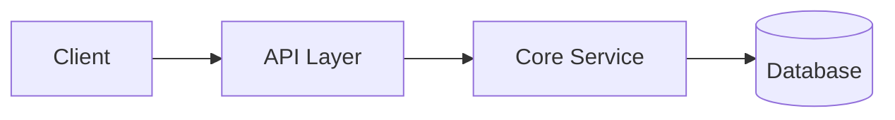

# {{title}}

## Overview
High-level overview of the component or system architecture.

## Component Boundaries & Data Flow
Describe the main components and how data flows between them.

## Core Constraints
- **Constraint 1**: Key architectural constraint.
- **Constraint 2**: Key architectural constraint.

## Related
- [[decisions/index]]
- [[project-state]]
