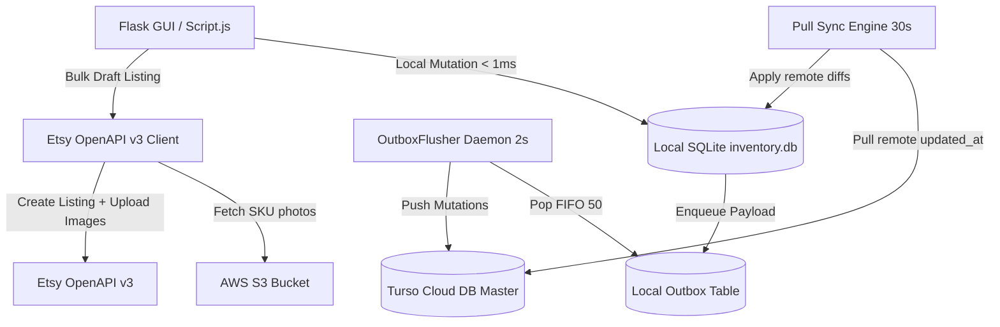

# TGNJ System Architecture

## Overview
TGNJ Inventory Manager is a local-first system designed for zero UI latency (< 1ms). Local user operations write directly to a local SQLite database (`inventory.db`) and immediately populate an atomic `outbox` queue table.

## Component Boundaries & Data Flow

## Core Constraints & Invariants
1. **Local-First Speed**: Direct local SQLite writes respond immediately to the UI without awaiting network.
2. **Outbox Enqueue Mandatory**: All REST API endpoints mutating inventory MUST call `db.enqueue_mutation()`.
3. **Field Isolation**: `UPDATE_FIELDS` mutations MUST NOT overwrite `etsy_listing_id` or `status` to prevent field erasure race conditions across multi-laptop setups.
4. **Zero-Dependency HTTP Clients**: `turso_client.py` and `etsy_client.py` use standard library `urllib` to maintain zero binary bloat.

## Related
- [[project-state]]
